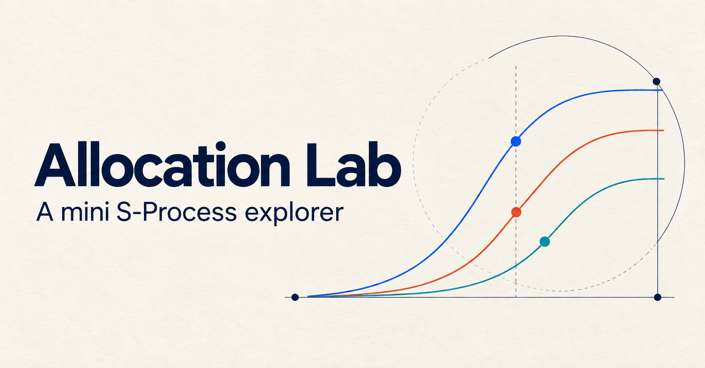

# Allocation Lab

An interactive mini S-Process explorer for understanding how multiple
evaluators, starting impact, and diminishing returns change a recommended
funding allocation.



## What it demonstrates

- A deterministic continuous optimizer, kept independent of React.
- Live allocation of a fixed $1 million budget across three illustrative
  organizations.
- Two evaluator profiles with adjustable relative influence and
  organization-specific scores.
- Direct manipulation of starting marginal utility and diminishing returns.
- Explanations that compare the current recommendation with a known baseline.
- Utility-curve visualization with the recommended allocations marked.
- Invariant-focused unit tests and browser tests for the critical user flows.

The organizations and utility values are fictional. The application is a small
decision-modeling demonstration, not a real grant recommendation.

## Mathematical model

The model first combines evaluator scores into an influence-weighted score:

```text
w̄ᵢ = Σₑ αₑ sₑᵢ / Σₑ αₑ
```

For organization `i`, funding `xᵢ` then produces utility

```text
Uᵢ(xᵢ) = w̄ᵢ mᵢ log(1 + dᵢ xᵢ / S) / dᵢ
```

where `αₑ` is evaluator influence, `sₑᵢ` is that evaluator's score for the
organization, `mᵢ` is initial marginal utility, `dᵢ > 0` controls diminishing
returns, and `S = $1,000,000` is a scaling constant.

The objective is to maximize `Σ Uᵢ(xᵢ)` subject to a complete, non-negative
allocation of the budget. Because every curve is concave, funded organizations
are optimal when their final marginal utilities are equal. The engine solves
for that shared marginal value with deterministic bisection. See
[the mathematical model](docs/mathematical-model.md) for the derivation and
edge-case behavior.

## Architecture

```text
allocation/
  evaluators.ts         evaluator-preference aggregation
  optimize.ts           budget-constrained optimizer
  utility.ts            utility and marginal-utility functions
  types.ts              framework-independent contracts
  optimize.test.ts      numerical invariants and edge cases

components/explorer/
  organization-editor.tsx
  evaluator-mix.tsx
  allocation-results.tsx
  utility-chart.tsx
  explanation-panel.tsx
  scenario.ts

tests/e2e/
  explorer.spec.ts      interaction, reset, and result-completeness flows
```

The optimizer has no UI or framework dependencies. React owns only scenario
state, presentation, and explanation of the result.

## Run locally

Requires Node.js 22.13 or newer.

```bash
npm install
npm run dev
```

Then open the local URL printed by Vite (normally `http://localhost:5173`).

For the standalone static build used by Netlify:

```bash
npm run dev:static
npm run build:static
```

The production files are written to `dist-static/`. The included
`netlify.toml` supplies the matching build command and publish directory, so the
repository can be imported into Netlify without additional build settings.

## Quality checks

```bash
npm test
npm run test:e2e
npm run lint
npm run build
```

The unit suite covers budget conservation, non-negativity, determinism, zero
budget, equal curves, zero-value curves, extreme preferences, equalized final
marginals, invalid parameters, and allocation monotonicity when starting utility
increases. The evaluator suite checks weighted aggregation, influence extremes,
invalid profiles, and the resulting allocation direction. Playwright verifies
live preference changes, baseline reset, the guided evaluator example, and the
complete analytical result.

## Product and engineering choices

- **Fixed organizations and budget:** this keeps the first version focused on
  understanding preference sensitivity, not form-building.
- **Continuous allocation:** the model exposes the marginal-utility logic more
  clearly than a coarse dollar-by-dollar simulation.
- **Automatic recalculation:** every control change produces an immediate answer
  and explanation; a redundant submit step would slow comparison.
- **Baseline comparison:** dollar deltas and plain-language parameter effects
  make “why did this move?” answerable without reading the formula.
- **No persistence or accounts:** the MVP contains no sensitive data and does
  not need a backend. Adding infrastructure would not improve the core
  demonstration.

The dependency set was upgraded from the generated scaffold to remediate direct
React, Vite, Cloudflare, and image-processing advisories. `npm audit` still
reports a transitive `braces` denial-of-service advisory in Vinext's build chain;
there is no patched upstream release at the time of this build. The application
does not accept glob patterns or untrusted build input.

## Natural next steps

1. Support saved/shareable scenarios through URL-safe state.
2. Compare social-welfare aggregation rules side by side.
3. Add evaluator names and profiles dynamically.
4. Add property-based tests over randomly generated valid utility curves.

Those extensions are deliberately outside this MVP until the central model and
interaction are proven.
